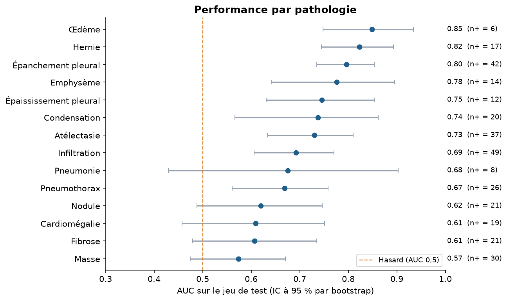
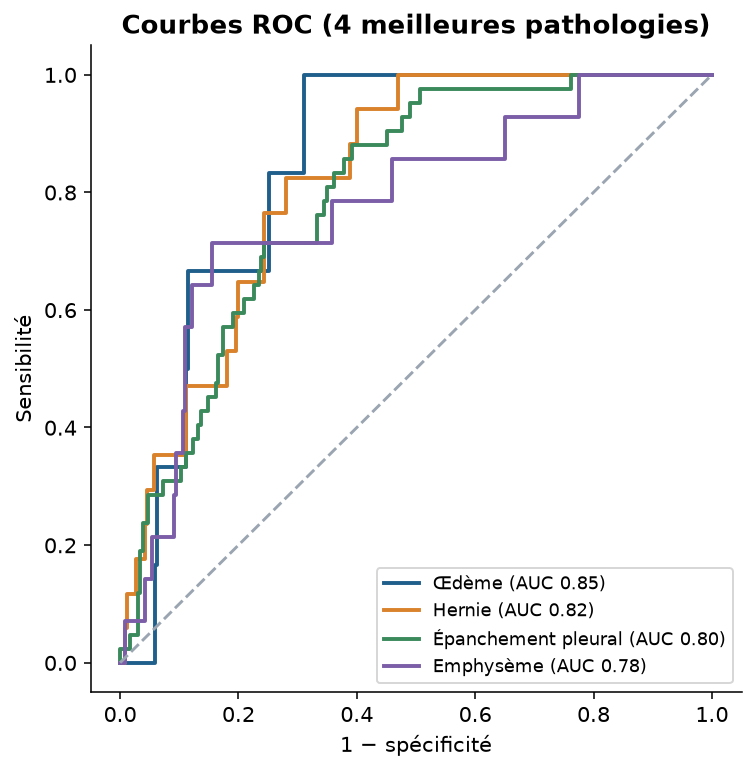
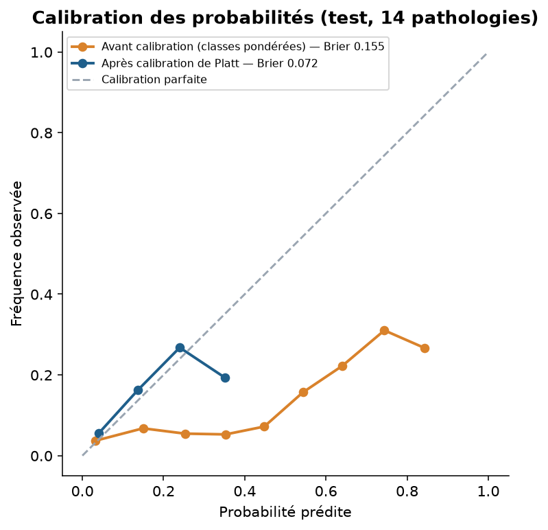
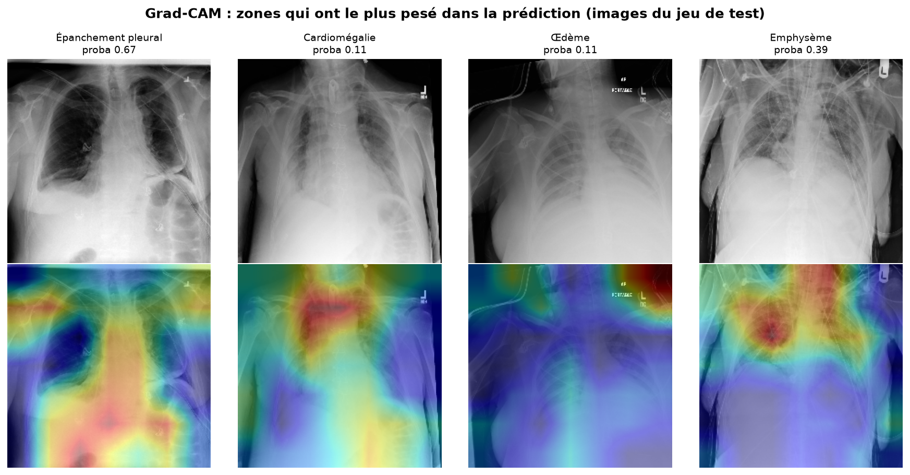

# Radiographies thoraciques : détection de 14 pathologies et évaluation comme un test diagnostique

Détection de **14 pathologies** sur des radiographies thoraciques de la base publique **NIH ChestX-ray8**, par **transfert d'apprentissage** (DenseNet121 pré-entraîné sur ImageNet), puis évaluation comme on évalue un **test médical** : AUC avec intervalles de confiance, sensibilité, spécificité, valeurs prédictives, calibration des probabilités et explication des prédictions par **Grad-CAM**.

Projet personnel qui prolonge le cours d'IA pour la santé (Polytech Lille, ISIA 5), avec un code entièrement original. Il tourne sur un ordinateur portable, sans carte graphique.



## Démarche

1. **Données** : 1 420 radiographies de 1 317 patients, 14 pathologies, chaque image pouvant en présenter plusieurs (multi-étiquette). Classes très déséquilibrées : de 3 à 17 % de cas positifs selon la pathologie.
2. **Découpage par patient** (train 934 / validation 209 / test 277) : un même patient n'apparaît jamais dans deux ensembles, sinon le modèle « reconnaîtrait » le patient plutôt que la maladie.
3. **Caractéristiques** : chaque image passe dans DenseNet121 (poids ImageNet, réseau gelé), qui la résume en 1 024 valeurs.
4. **Un classifieur par pathologie** : régression logistique **pondérée par classe** (l'équivalent d'une perte pondérée), régularisation choisie sur la validation.
5. **Calibration de Platt** sur la validation : la pondération gonfle les probabilités, la calibration les ramène à des fréquences réelles.
6. **Seuil de décision** par pathologie, choisi sur la validation (indice de Youden), puis appliqué au test.

## Résultats (jeu de test, 277 radiographies)

**AUC moyenne : 0,71** (médiane 0,71). Les meilleures pathologies : œdème (0,85), hernie (0,82), épanchement pleural (0,80), emphysème (0,78). Les plus difficiles : masse (0,57), fibrose et cardiomégalie (0,61).

| Pathologie | Cas positifs | AUC [IC 95 %] | Sensibilité | Spécificité | VPP | VPN |
|---|---|---|---|---|---|---|
| Épanchement pleural | 42 | 0,80 [0,74 ; 0,85] | 0,62 | 0,79 | 0,34 | 0,92 |
| Atélectasie | 37 | 0,73 [0,63 ; 0,81] | 0,81 | 0,55 | 0,22 | 0,95 |
| Infiltration | 49 | 0,69 [0,61 ; 0,77] | 0,67 | 0,64 | 0,28 | 0,90 |
| Pneumothorax | 26 | 0,67 [0,56 ; 0,76] | 0,58 | 0,69 | 0,16 | 0,94 |

Toutes les pathologies : [`outputs/resultats_par_pathologie.csv`](outputs/resultats_par_pathologie.csv).

**Ce qu'il faut retenir**

- **Les intervalles de confiance sont larges** : avec 6 à 49 cas positifs par pathologie dans le test, une AUC de 0,85 sur 6 cas (œdème) est bien moins fiable qu'une AUC de 0,80 sur 42 cas (épanchement). Le bootstrap le rend visible.
- **Une bonne VPN, une faible VPP** : quand une maladie est rare, même un test correct produit beaucoup de faux positifs. Pour l'épanchement pleural, un résultat négatif est fiable à 92 %, un résultat positif ne l'est qu'à 34 %. Ce modèle serait donc plutôt un outil d'**exclusion** ou de tri, pas de diagnostic.
- **La calibration est indispensable** : la pondération des classes surestime fortement les probabilités ; la calibration de Platt divise par deux l'erreur de Brier (0,155 → 0,072).
- **Grad-CAM révèle une limite importante** : le modèle regarde souvent hors des poumons (cou, marqueurs du radiologue, bords de l'image). Avec un réseau gelé entraîné sur des photos ordinaires et seulement 934 images, il apprend des raccourcis. C'est la raison principale des AUC modestes, et ce que corrigerait un ré-entraînement (fine-tuning) sur un grand nombre de radiographies.

| Courbes ROC | Calibration |
|---|---|
|  |  |



**Notebook pas à pas :** [`notebooks/analyse_radiographies.ipynb`](notebooks/analyse_radiographies.ipynb) reprend toute la démarche, déjà exécuté.

## Lancer le projet

Les images ne sont pas versionnées. Elles proviennent du NIH Clinical Center (domaine public) :
[NIH ChestX-ray8](https://nihcc.app.box.com/v/ChestXray-NIHCC) — télécharger une ou plusieurs archives `images_xxx.tar.gz` et le fichier d'étiquettes `Data_Entry_2017.csv`.

```bash
python -m venv .venv
.venv\Scripts\activate            # Windows (source .venv/bin/activate sous Linux / macOS)
pip install -r requirements.txt

set CXR_IMAGES=C:\chemin\vers\images                # dossier des .png
set CXR_LABELS=C:\chemin\vers\Data_Entry_2017.csv   # converti automatiquement
python main.py                    # caractéristiques (mises en cache), modèles, évaluation, figures
python -m pytest                  # tests (sans images)
```

## Structure

```
├── notebooks/              # notebook pas à pas, déjà exécuté
├── main.py                 # pipeline complet
├── src/
│   ├── data.py             # étiquettes (dont le format officiel NIH), découpage par patient
│   ├── features.py         # DenseNet121 ImageNet, extraction et cache des caractéristiques
│   ├── model.py            # régressions logistiques pondérées, calibration de Platt
│   ├── evaluation.py       # AUC + bootstrap, seuil de Youden, sensibilité, spécificité, VPP, VPN, calibration
│   └── gradcam.py          # cartes Grad-CAM
├── tests/                  # tests unitaires
├── outputs/                # figures et résultats
└── requirements.txt
```

## Limites et pistes

- Petit échantillon (1 420 images sur les 112 000 de la base complète) : les AUC publiées avec le jeu complet et un réseau ré-entraîné (de l'ordre de 0,75 à 0,84 en moyenne) ne sont pas atteignables ici.
- Étiquettes extraites automatiquement des comptes rendus par le NIH : elles contiennent du bruit.
- Pistes : fine-tuning des derniers blocs de DenseNet sur GPU, augmentation de données, davantage d'images, validation sur une autre base (CheXpert, MIMIC-CXR).

## Outils

Python · TensorFlow / Keras · scikit-learn · NumPy · pandas · Matplotlib
